<div align="center">

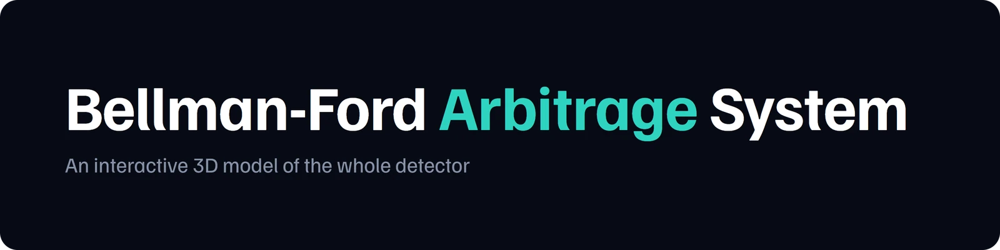

### An interactive 3D model of a forex arbitrage detector

A single-page, step-by-step walkthrough of a **Spring Boot + Java Swing** application that finds currency arbitrage with the **Bellman-Ford** algorithm. Every Java class is a block you can orbit, click and trace, and every step of the algorithm plays out live on a 3D currency graph.


### [▶ Open the live model](https://model-analysis-for-the-arbitage-sys.vercel.app)

**Official link:** [model-analysis-for-the-arbitage-sys.vercel.app](https://model-analysis-for-the-arbitage-sys.vercel.app)

<br>

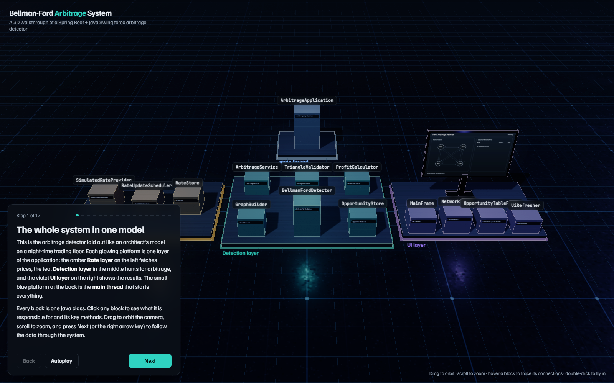

</div>

---

## Contents

- [What this is](#what-this-is)
- [The idea in 30 seconds](#the-idea-in-30-seconds)
- [The 17-step tour](#the-17-step-tour)
- [Interact with the model](#interact-with-the-model)
- [Architecture being modelled](#architecture-being-modelled)
- [Run it locally](#run-it-locally)
- [Deploy](#deploy)
- [How it is built](#how-it-is-built)

---

## What this is

Arbitrage means converting money around a loop of currencies, for example **USD → EUR → GBP → USD**, and ending with more than you started with. It happens when exchange rates are briefly inconsistent with each other.

This project is a **visual explainer** for a Java application that detects those loops in real time. Instead of reading code, you walk through the system on a 3D trading floor:

| Layer | Colour | What lives there |
| --- | --- | --- |
| **Rate layer** | Amber | `SimulatedRateProvider`, `RateUpdateScheduler`, `RateStore` |
| **Detection layer** | Teal | `GraphBuilder`, `BellmanFordDetector`, `ArbitrageService`, `TriangleValidator`, `ProfitCalculator`, `OpportunityStore` |
| **UI layer** | Violet | `MainFrame`, `NetworkPanel`, `OpportunityTablePanel`, `UiRefresher` |
| **main thread** | Blue | `ArbitrageApplication`, the Spring Boot entry point |

---

## The idea in 30 seconds

Money **multiplies** as it moves through a loop. A loop is profitable when

```
rate(USD→EUR) × rate(EUR→GBP) × rate(GBP→USD) > 1
```

Shortest-path algorithms **add** weights instead of multiplying them. Taking a logarithm bridges the two, because `log(a × b) = log a + log b`. If every edge gets the weight

```
w = −log(rate × (1 − fee))
```

then *"product greater than 1"* becomes *"sum less than 0"*. A profitable loop is now a **negative-weight cycle**, which Bellman-Ford is built to detect:

1. Start every node at `dist = 0`.
2. Relax all edges **V − 1** times.
3. If a **V-th** pass can still lower any distance, a negative cycle exists.
4. Walk the `parent[]` pointers back V times to land inside the cycle, then trace it.

With the demo rates: `0.90 × 0.88 × 1.27 = 1.00584`, which is **+0.433 % after fees**.

---

## The 17-step tour

Press **Next** (or the → key) and the camera flies to each part of the system while the data panel explains what is happening.

<table>
  <tr>
    <td width="50%">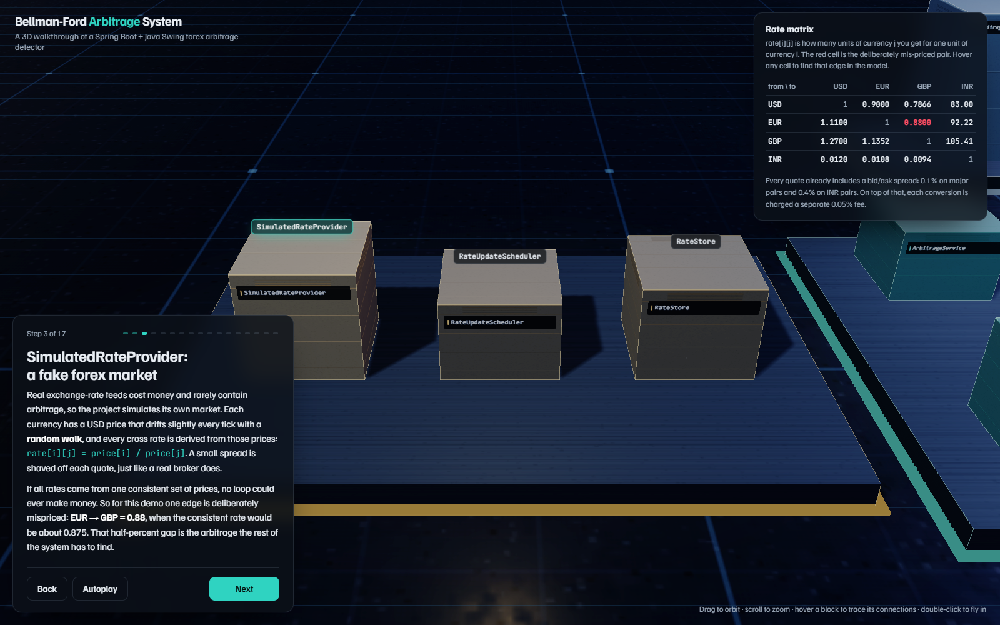</td>
    <td width="50%">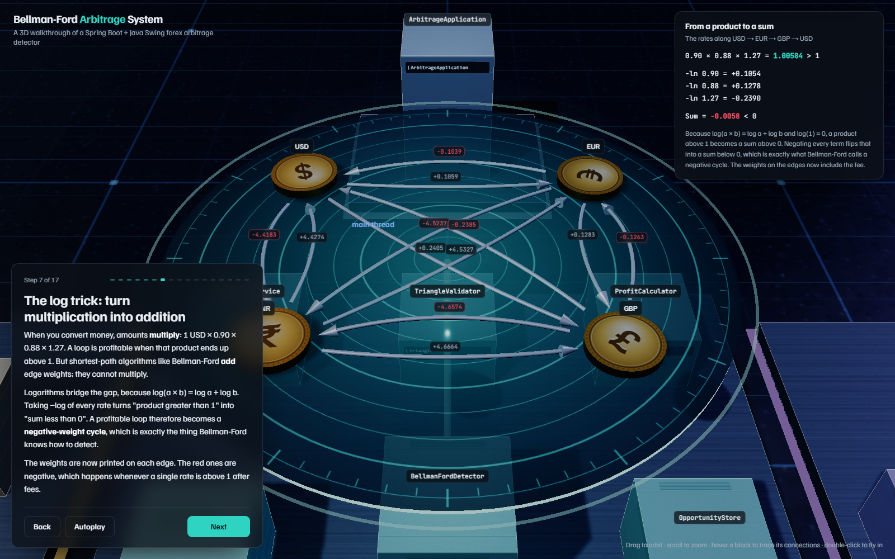</td>
  </tr>
  <tr>
    <td><b>A simulated market.</b> Prices drift with a random walk, and one pair (EUR → GBP) is deliberately mispriced so there is an arbitrage to find.</td>
    <td><b>The log trick.</b> Four minted coins become graph nodes. Each of the 12 directed edges shows its <code>−log</code> weight, and negative ones turn red.</td>
  </tr>
  <tr>
    <td>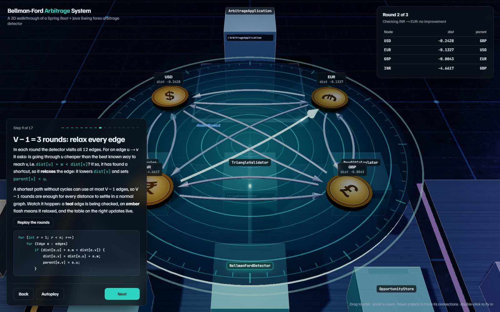</td>
    <td>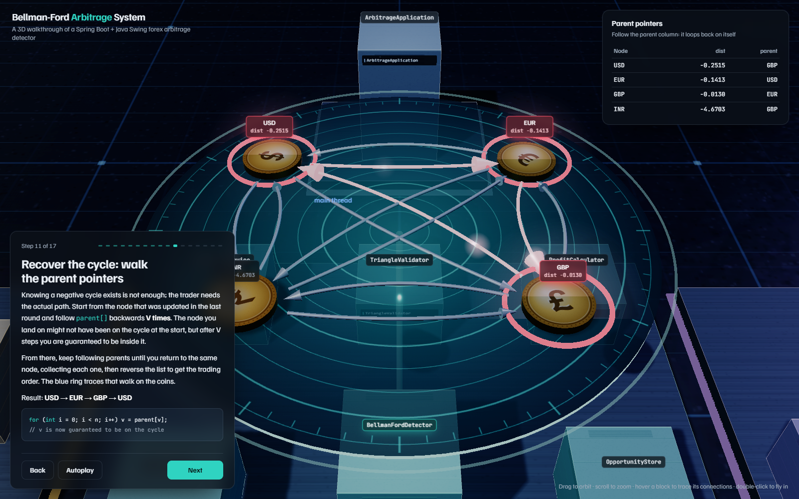</td>
  </tr>
  <tr>
    <td><b>V − 1 relaxation rounds, animated.</b> Teal means the edge is being checked, amber means it relaxed. The distance table updates live, edge by edge.</td>
    <td><b>Recovering the cycle.</b> Parent pointers are walked on the coins until the loop closes, and the arbitrage cycle lights up in red.</td>
  </tr>
  <tr>
    <td>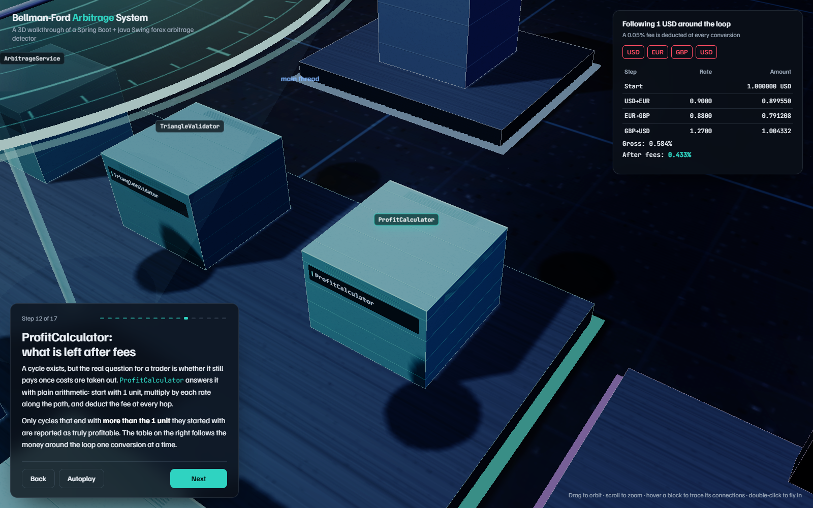</td>
    <td>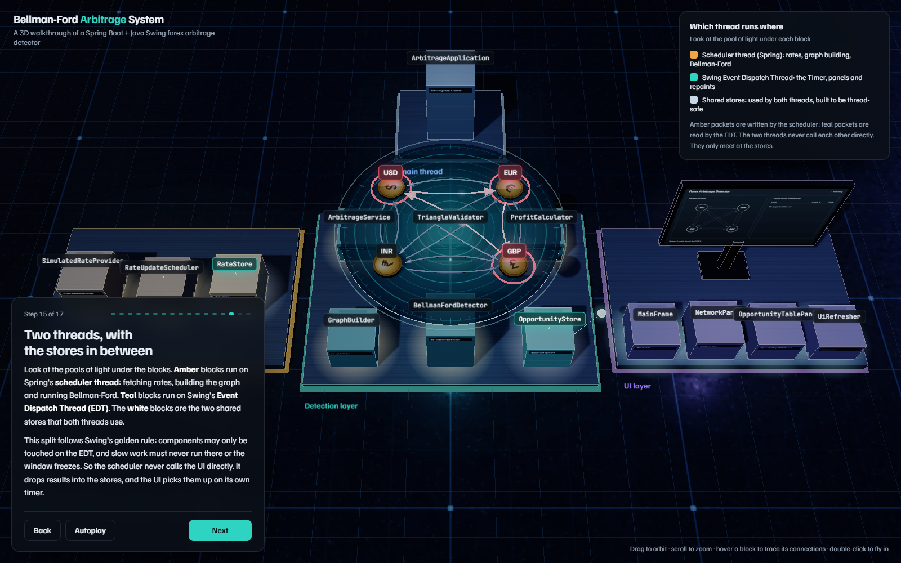</td>
  </tr>
  <tr>
    <td><b>Profit after fees.</b> One USD is followed around the loop, conversion by conversion, with the fee deducted at every hop.</td>
    <td><b>Two threads.</b> Pools of light show which blocks run on Spring's scheduler thread and which on Swing's Event Dispatch Thread. The two meet only at the shared stores.</td>
  </tr>
  <tr>
    <td>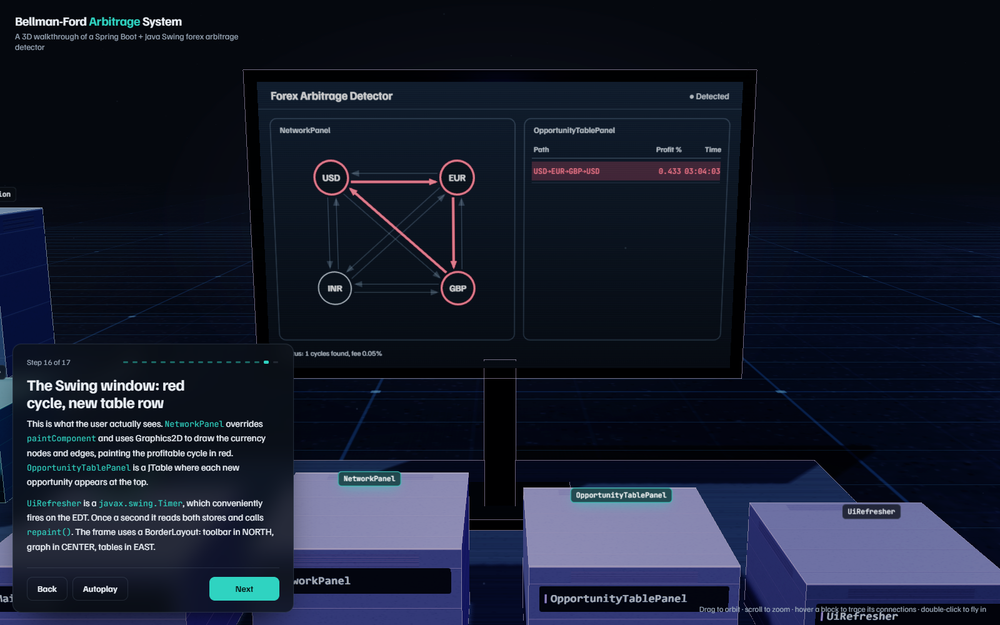</td>
    <td>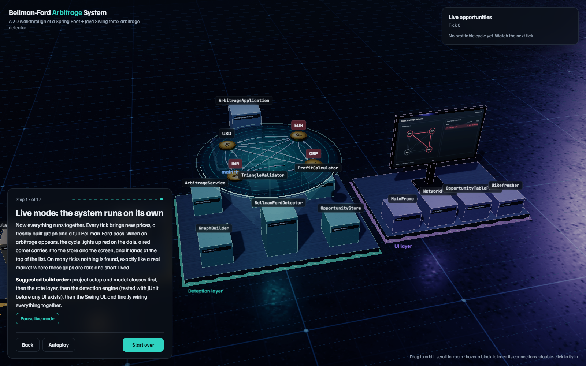</td>
  </tr>
  <tr>
    <td><b>The Swing window.</b> The 3D monitor renders the real UI: <code>NetworkPanel</code> draws the cycle in red and <code>OpportunityTablePanel</code> lists each hit.</td>
    <td><b>Live mode.</b> Every tick brings new rates, a new graph and a full Bellman-Ford pass. Opportunities appear and vanish as they would in a real market.</td>
  </tr>
</table>

> **Tip:** you can link straight to any step, for example `index.html#step-9`.

---

## Interact with the model

<table>
  <tr>
    <td width="50%">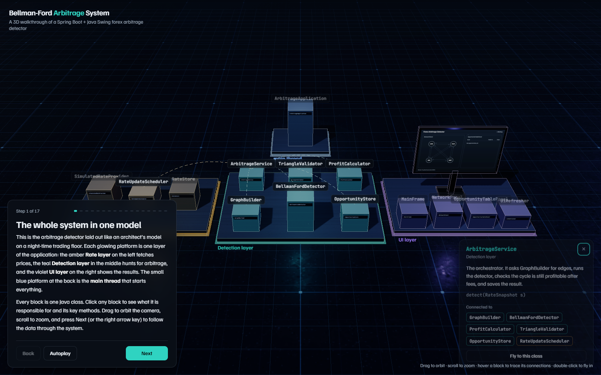</td>
    <td width="50%">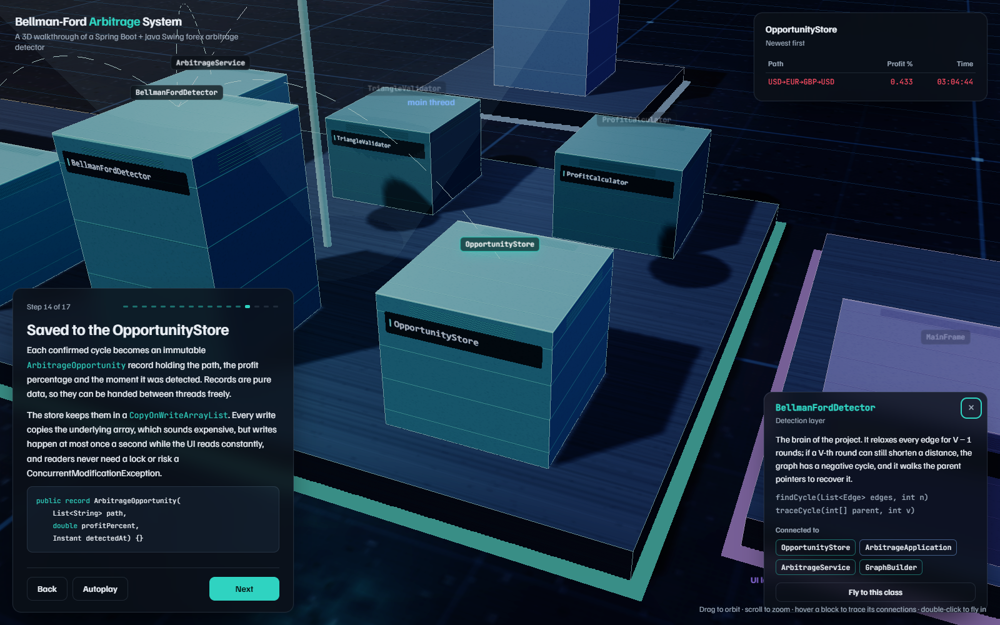</td>
  </tr>
  <tr>
    <td><b>Trace connections.</b> Hover or click a block: dashed arcs connect it to every class it talks to, and everything else dims.</td>
    <td><b>Class details.</b> Each class shows its responsibility, its key methods and clickable links to connected classes. A link opens that class and flies the camera to it.</td>
  </tr>
</table>

| Action | What happens |
| --- | --- |
| **Drag** / **scroll** / **pinch** | Orbit and zoom the camera |
| **Hover a block** | Trace its dependencies, dim unrelated classes |
| **Click a block** | Open its details: role, methods, connected classes |
| **Double-click a block** | Fly the camera to it |
| **Hover a coin** | See that currency's rates to the other three |
| **Hover a graph edge** | See its rate, its `−log` weight and whether it is part of the cycle |
| **Hover a table row or cell** | Light up the matching edge, node or cycle in 3D |
| **← / →**, **Esc** | Previous or next step, close the popup |
| **Autoplay** | Run the whole tour hands-free |

<div align="center">
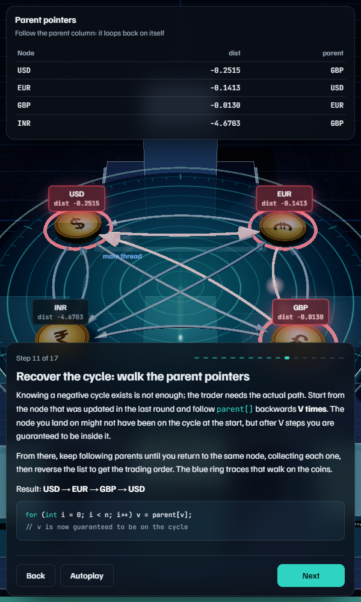
<br><sub>It works on phones too: the panels stack and the model stays touch-orbitable.</sub>
</div>

---

## Architecture being modelled

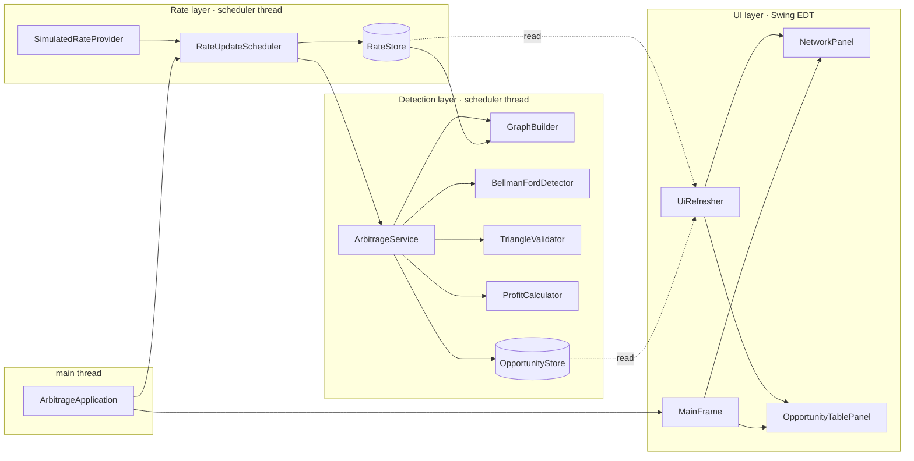

**Thread-safety design**

- `RateStore` holds an immutable snapshot behind an `AtomicReference`, so readers never see half-updated prices.
- `OpportunityStore` uses a `CopyOnWriteArrayList`, so the UI iterates without locks while the scheduler appends.
- The scheduler never calls Swing. A `javax.swing.Timer` pulls from the stores on the EDT once a second.

---

## Run it locally

Just want to try it? Use the live version at **[model-analysis-for-the-arbitage-sys.vercel.app](https://model-analysis-for-the-arbitage-sys.vercel.app)**.

There is no build step and nothing to install. It is one HTML file.

```bash
git clone https://github.com/chandan-kumar-git/arbitrage-detector-3d.git
cd arbitrage-detector-3d
```

Then either open `index.html` directly in Chrome, Edge or Firefox, or serve the folder:

```bash
npx serve .          # or: python -m http.server 8000
```

> Three.js and fonts load from public CDNs, so the first load needs an internet connection.

---

## Deploy

The official deployment runs on Vercel at **https://model-analysis-for-the-arbitage-sys.vercel.app**. To host your own copy, any static host works:

- **GitHub Pages:** *Settings → Pages → Deploy from branch → `main` / root*
- **Vercel:** `npx vercel --prod` from the project folder (framework preset: *Other*, no build command)
- **Netlify:** drag the folder onto app.netlify.com/drop

---

## How it is built

| | |
| --- | --- |
| **Rendering** | Three.js r128 (WebGL), ACES tone mapping, soft shadows, a subtle bloom pass with a plain-render fallback |
| **Materials** | Every texture is procedural, drawn on `<canvas>` at runtime: the etched floor grid, brushed metal, panel seams, engraved nameplates, minted coin faces and the holographic dais. No image assets. |
| **Algorithm** | A real Bellman-Ford runs in the browser. Every relaxation is recorded as an event and replayed as animation, so what you see is the actual computation. |
| **Live mode** | Gaussian random-walk prices with occasional injected mispricing, re-detected every tick |
| **UI** | Vanilla JS and CSS, `Familjen Grotesk` + `JetBrains Mono`, `prefers-reduced-motion` respected, keyboard navigable |

```
.
├── index.html              # the entire app: scene, algorithm, tour, UI
├── README.md
└── docs/screenshots/       # images used in this README
```

<div align="center">
<br>
Built by <a href="https://github.com/chandan-kumar-git">Chandan Kumar</a>
</div>
